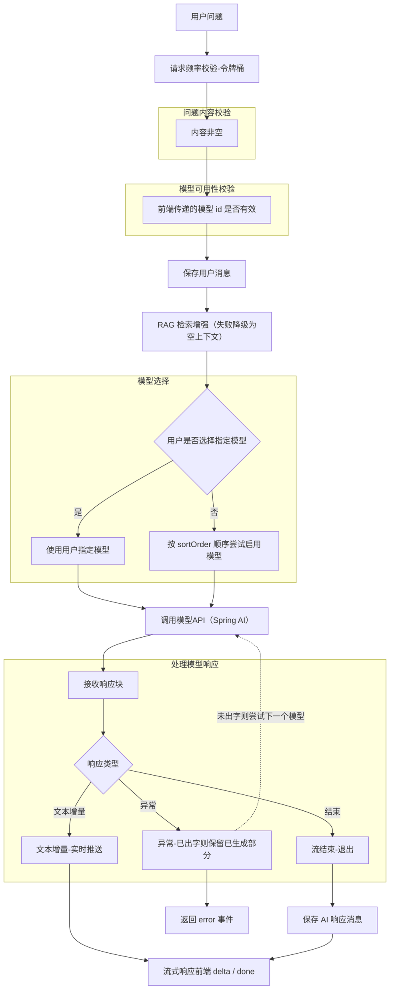

# AI 数字生命对话模块设计

> 更新于 2026-11-19。模型调用层已完成「方案 A」改造（手写 HTTP → Spring AI），后续优化项见第 4 节。

## 1. 主流程（当前实现）

下图只画**已经落地**的环节，与代码一一对应；暂未实现的目标流程见 1.1。



### 1.1 后期扩展（当前未实现）

| 扩展点 | 插入位置 | 说明 |
|---|---|---|
| 内容合规性校验 | 「内容非空」之后 | 代码里是 `// todo 问题内容合规性检查` |
| 用户余额充足校验 | 「模型 id 是否有效」之后 | 目前全库无余额/配额实现，扣减方案见 4.5 |
| 模型选择 agent（planB） | 「模型选择」分支 | 当前只有 planA（按 `sortOrder` 顺序尝试） |
| 上下文内存记忆 | 「保存用户消息」之后 | 现为每轮查库，见 4.1 |
| 相似度阈值 / refType 过滤 | RAG 检索 | 现为全表 topK，见 4.4 |

## 2. 代码结构

| 层 | 类 | 职责 |
|---|---|---|
| 入口 | `ChatController` | `POST /api/user/digital-life/chat`，限流 + 模型预检后返回 `SseEmitter`（事件 `delta` / `done` / `error`） |
| 编排 | `ChatServiceImpl` | 用户消息入库 → RAG → 拼 messages → 多模型顺序 fallback → 回复入库 |
| 模型调用 | `ModelClient` | 唯一模型出口：`chat` / `streamChat` / `embed`，底层为 Spring AI `OpenAiChatModel` / `OpenAiEmbeddingModel` |
| 模型配置 | `ModelConfigServiceImpl` | `dl_models` 表驱动，AES-GCM 密文 Key，运行时增删改与连通性测试 |
| RAG | `VectorServiceImpl` + `VectorMapper` | 远程 embedding → PostgreSQL pgvector 余弦检索（`dl_vectors`） |
| 持久化 | `ChatMessageMapper` | `chat_messages` 表，无独立会话表，按 `session_id` 聚合 |
| 限流 | `RateLimitServiceImpl` | Redis Lua 令牌桶，Redis 不可用时冷却期内放行 |

## 3. 已落地：模型调用层切换到 Spring AI（方案 A）

### 3.1 依赖

```xml
<dependencyManagement>
  <dependency>
    <groupId>org.springframework.ai</groupId>
    <artifactId>spring-ai-bom</artifactId>
    <version>1.0.0</version>
    <type>pom</type>
    <scope>import</scope>
  </dependency>
</dependencyManagement>

<dependency>
  <groupId>org.springframework.ai</groupId>
  <artifactId>spring-ai-openai</artifactId> <!-- 只引客户端库，不引 starter，避免自动配置锁死单例模型 -->
</dependency>
```

### 3.2 `ModelClient` 改造要点

1. **对外签名不变**：`chat` / `streamChat(... , Consumer<String> onDelta)` / `embed` 三个方法保持原样，`ChatServiceImpl`、`VectorServiceImpl`、`TrainingServiceImpl`、`SummaryServiceImpl`、`ModelConfigServiceImpl` 零改动。
2. **模型实例按调用参数动态构建**：`OpenAiApi.builder().baseUrl(baseUrl).apiKey(key)`，因此 `dl_models` 表里增删改、切 Key、切 baseUrl 依然即时生效，不受 yml 单例限制。
3. **路径约定保留**：库里的 baseUrl 已含 `/v1`（如 `https://open.bigmodel.cn/api/paas/v4`），故显式指定 `completionsPath("/chat/completions")`、`embeddingsPath("/embeddings")`，与改造前完全一致，避免出现 `/v1/v1/...`。
4. **流式不再手写 SSE 解析**：`chatModel.stream(prompt)` 返回 `Flux<ChatResponse>`，用 `timeout(120s).toIterable()` 阻塞消费，逐块取 `getResult().getOutput().getText()` 回调，`[DONE]` 哨兵与 `data:` 前缀解析全部由 Spring AI 接管。
5. **超时**：非流式走 `SimpleClientHttpRequestFactory`（连接 15s / 读 120s）；流式走 `JdkClientHttpConnector(java.net.http.HttpClient)`，避免为了一个连接器引入 reactor-netty。
6. **异常语义保持一致**：Spring AI 的 `RestClientResponseException` / `WebClientResponseException` 统一解包（含 Reactor 的 `ReactiveException` 包装）后，复用原有 `error.message` 提取逻辑，最终仍抛 `ModelClient.ModelException`，前端看到的错误文案不变。

### 3.3 与原实现的差异

| 项 | 改造前 | 改造后 |
|---|---|---|
| HTTP | `java.net.http.HttpClient` 手拼 JSON | Spring AI `OpenAiApi`（RestClient / WebClient） |
| 流式 | 手写 `readLine` + `data:` + `[DONE]` | `Flux<ChatResponse>` |
| Embedding | 手写 `/embeddings` 解析 float 数组 | `OpenAiEmbeddingModel.embedForResponse` |
| 连接复用 | 单例 HttpClient | 每次调用新建（模型密钥不驻留内存的取舍，见 4.7） |
| 协议扩展 | 仅 OpenAI 兼容 | 后续可接 Anthropic / Ollama 原生实现（见 4.6） |

### 3.4 验证状态

- `mvn compile` 通过（JDK 21 / Boot 3.5.3 / Spring AI 1.0.0）。
- **未做真实调用验证**：本地无可用模型 Key，`chat` / `streamChat` / `embed` 的端到端行为需在配置了 `dl_models` 的环境用「模型管理 → 连通性测试」与一次真实对话确认。

## 4. 待优化项

### 4.1 会话上下文：从「每次查库」改为内存记忆（优先级：高）

**现状**：`ChatServiceImpl.run` 每轮对话都执行

```java
// 用户消息先入库 → 再从库里把最近 20 条查回来 → 跳过自己拼成 messages
for (ChatMessage history : getHistory(userId, sessionId, CONTEXT_MESSAGE_LIMIT)) {
    if (history.getId().equals(userMessage.getId())) continue;
    messages.add(Map.of("role", ..., "content", history.getContent()));
}
```

问题：

1. 每轮对话多一次 DB 往返，且刚插入的消息要「查回来再跳过」，逻辑绕。
2. 消息体是 `List<Map<String,String>>`，非强类型，无法承载多模态、tool call、usage 等信息。
3. 窗口按「条数 20」硬编码，不是按 token，长消息容易超模型上下文。

**方案 B1（推荐先做，改动最小）**：进程内会话记忆 + 冷启动回填

- `ConcurrentHashMap<String, Deque<Message>>`（或 Caffeine，`maximumSize` 上限 + `expireAfterAccess` 30 分钟），key = `userId + ":" + sessionId`。
- 首次访问（cache miss）从 `chat_messages` 回填最近 20 条，命中后只做追加，不再查库。
- 写入顺序改为：内存先追加 → 用户消息入库（保留现有「提问必落库」语义）。
- 失效策略：`done` 后写入助手消息到缓存；后台删除会话、管理员清理消息时调用 `evict(userId, sessionId)`。
- 注意：多实例部署时各节点缓存不一致，需粘性会话，或直接跳过 B1 做 B2。

**方案 B2（切 ChatClient 时一起做）**：Spring AI `ChatMemory` + 自定义 `ChatMemoryRepository`

- 用 `MessageWindowChatMemory`（窗口 20）承载窗口策略，`ChatMemoryRepository` 自定义实现，内部「缓存 + `chat_messages` 回写」，业务表仍是唯一真相源。
- 关键约束：`conversationId` 必须映射为 `userId:sessionId`；`ChatMemory` 只存 content/role，`id`、`ip`、`created_at` 等业务列仍需自己写入，不能直接替换 `ChatMessage` 实体。
- 接入方式（方案 B 落地后）：

```java
ChatClient.builder(chatModel)
        .defaultAdvisors(MessageChatMemoryAdvisor.builder(chatMemory).build())
        .build();
```

**结论**：先做 B1 消除「每轮查库」，等切 `ChatClient`（4.2）时再统一为 B2，避免两次重构。

### 4.2 Prompt 组装：字符串拼接 → `PromptTemplate` / Advisor（优先级：中）

- 现状 `ChatServiceImpl.buildSystemPrompt` 用 `String.join("\n\n", sections)` 手拼人格、基本信息、RAG 片段、反编造规则。
- 建议：人格段用 `PromptTemplate` + 占位符（`{name}` / `{style}` / `{basicInfo}`），RAG 片段改用 `QuestionAnswerAdvisor`（`searchRequest` 带 `topK` 与 `similarityThreshold`），反编造规则放 `defaultSystem`。收益是可测试、可复用、可给不同人格配不同模板。
- 注意保留现有「RAG 失败静默降级为空上下文，仍可正常对话」的行为：Advisor 需显式 `.onErrorResume(e -> Flux.empty())` 或自定义 Advisor，默认行为是抛异常。

### 4.3 多模型 fallback：Service 内 for 循环 → 显式路由组件（优先级：中）

- 现状 `ChatServiceImpl` 第 92-113 行手写循环，语义是「按 `sortOrder` 依次尝试；一旦已产出部分 token 则不再切换模型」。
- Spring AI 无内建 failover。建议抽出 `RoutingChatModel implements ChatModel`（或 `FallbackChatService`）：

```java
for (ChatModel candidate : candidates) {
    AtomicBoolean emitted = new AtomicBoolean(false);
    try {
        return candidate.stream(prompt).doOnNext(c -> emitted.set(true));
    } catch (Exception e) {
        if (emitted.get()) throw e; // 已出字，保留已生成部分
    }
}
```

- 收益：`ChatServiceImpl` 只负责编排；同款循环目前在 `SummaryServiceImpl` 也有一份，抽出来后共用。

### 4.4 RAG：手写 SQL → 自定义 `VectorStore` 适配（优先级：中）

- 保持 `dl_vectors` 表结构与 `ref_type / ref_id / chunk_index` 语义不变（后台训练、去重、覆盖逻辑都依赖它），不要换 `PgVectorStore` 默认表。
- 建议实现 `VectorStore` 接口，内部复用 `VectorMapper.search`，换取：Advisor 生态兼容、统一 `topK` / `similarityThreshold` 参数。
- 顺带补两个现存质量问题：`VectorMapper.search` 目前**全表检索、无 `refType` 过滤、无相似度阈值**，容易把无关片段塞进 prompt。

### 4.5 Token 统计与余额扣减（优先级：低，目标流程见 1.1）

- 「用户余额是否充足」目前**无实现**（全库无余额/配额相关代码），仅 Redis 令牌桶限流。
- 若要做：流式需开启 `OpenAiChatOptions.builder().streamUsage(true)`，从 `ChatResponse.getMetadata().getUsage()` 取 prompt/completion token；扣减应在 `done` 回调前完成，并给 `ChatService.ChatOptions` 增加 usage 回调位。

### 4.6 其他

| 项 | 现状 | 建议 |
|---|---|---|
| Anthropic | `PROVIDER_BASE_URLS` 有 `anthropic`，但走 OpenAI 协议，选中必失败 | 引入 `spring-ai-anthropic`，按 provider 分派构建对应 `ChatModel` |
| 模型参数 | `temperature=0.7` / `maxTokens=2048` / `dimensions=1024` / `topK=5` 全部硬编码 | `dl_models` 加 `temperature` / `max_tokens` 列，映射到 `OpenAiChatOptions` |
| 密钥驻留 | 每次调用解密后即用即弃 | 若后续加实例缓存（`OpenAiApi` 按 baseUrl+apiKey 缓存以复用连接池），需评估明文 Key 常驻堆内的风险 |
| SSE 契约 | `ChatController` 返回 `Object`（开流前 429/409 JSON + 开流后 SSE） | 若切 WebFlux，需保留该契约与 `retryAfterSeconds` 字段；单实例 MVC + `SseEmitter` 可继续用 |
| 上下文窗口 | 按条数 20，非 token | 结合 4.1 一并改为按 token 裁剪（可用 Spring AI `TokenCountEstimator`） |

## 5. 优先级建议

| 顺序 | 事项 | 预期收益 | 工作量 |
|---|---|---|---|
| 1 | 4.1 方案 B1（内存记忆 + 冷启动回填） | 每轮少一次 DB 查询、消息体可强类型化 | 0.5~1 天 |
| 2 | 4.3 抽 `RoutingChatModel` | 编排层瘦身，两处循环合并 | 1 天 |
| 3 | 4.2 + 4.1 方案 B2（`ChatClient` + `ChatMemory` + Advisor） | 与 Spring AI 生态对齐，便于接工具调用/结构化输出 | 3~5 天 |
| 4 | 4.4 自定义 `VectorStore` + 阈值/过滤 | 检索质量可调，Advisor 可复用 | 2 天 |
| 5 | 4.5 token 统计 → 计费 | 支撑 1.1 的余额校验 | 2 天 |
| 6 | 4.6 其余 | 体验/可维护性 | 按需 |
