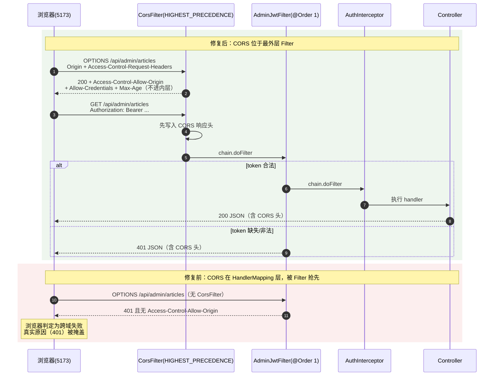
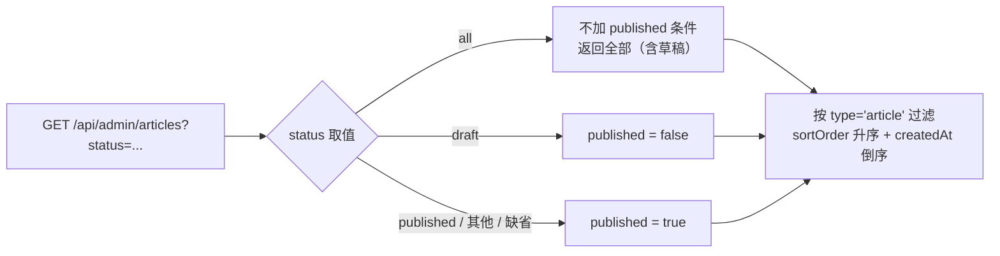

# 详细设计

> 记录后端关键链路的设计与实现约束。图形均使用 Mermaid 文本描述，可直接编辑。

---

## 一、跨域（CORS）请求链路

### 1.1 背景

前端开发服务器在 `http://localhost:5173`，`frontend/src/composables/useApi.js` 在开发环境直连
`http://localhost:3000/api`，因此所有请求都是**跨域请求**，并且需要携带凭证（admin/user token 走
`Authorization`，访客登录态走 `user_token` cookie），后端必须返回
`Access-Control-Allow-Credentials: true` 与精确的 `Access-Control-Allow-Origin`。

曾出现的问题：未登录访问 `/api/admin/**` 时浏览器报「跨域被拦截」，而不是返回 401。
原因是 CORS 只配置在 HandlerMapping 层，鉴权 Filter 在它之前就返回了 401，响应里没有任何 CORS 头。

### 1.2 请求路径（修复后）

```mermaid
flowchart TB
    Browser["浏览器 localhost:5173<br/>useApi 直连 3000"]
    Preflight{"请求方法 = OPTIONS<br/>且带 Access-Control-Request-Method ?"}

    subgraph FilterChain["Servlet Filter 链（按 order 从外到内）"]
        Cors["CorsFilter<br/>order = HIGHEST_PRECEDENCE<br/>WebMvcConfig#corsFilterRegistration"]
        AdminJwt["AdminJwtFilter<br/>@Order(1)，仅 /api/admin/**"]
        UserJwt["UserJwtFilter<br/>@Order(2)，仅 /api/user/**"]
    end

    subgraph MvcLayer["Spring MVC 层"]
        Interceptor["AuthInterceptor<br/>addPathPatterns = /api/**"]
        Controller["Controller<br/>ArticleAdminController 等"]
    end

    Response["JSON 响应 + CORS 头"]

    Browser --> Preflight
    Preflight -->|是| Cors
    Cors -->|预检直接响应 200<br/>不回源| Browser
    Preflight -->|否| Cors
    Cors -->|写入 CORS 响应头后放行| AdminJwt
    AdminJwt -->|token 合法 / 非 admin 路径| UserJwt
    AdminJwt -->|token 缺失或非法| Unauthorized["401 Unauthorized<br/>仍带 CORS 头"]
    UserJwt --> Interceptor
    Interceptor -->|@Auth 校验通过| Controller
    Controller --> Response
    Response --> Browser
    Unauthorized --> Browser
```

### 1.3 修复前后对比



### 1.4 关键约束

| 约束 | 说明 | 代码位置 |
|---|---|---|
| CORS 必须在 Filter 层 | 鉴权 Filter 会在 MVC 之前直接返回 401，只有 Filter 层的 CORS 才能覆盖所有响应 | `config/WebMvcConfig#corsFilterRegistration` |
| 顺序最高 | `FilterRegistrationBean#setOrder(Ordered.HIGHEST_PRECEDENCE)`，早于 `AdminJwtFilter(@Order(1))`、`UserJwtFilter(@Order(2))` | 同上 |
| 允许凭证 | `allowCredentials = true` 时不能用 `allowedOrigins("*")`，必须用 `allowedOriginPatterns("*")`，由框架回显具体 Origin | 同上 |
| 暴露响应头 | 前端需要读取 `Content-Disposition`（下载）与 `X-Feed-Site-Url-Source` | 同上 |
| 不要重复配置 | 已移除 `addCorsMappings`，避免与 Filter 层重复处理同一响应 | `config/WebMvcConfig` |

### 1.5 验证方式

```powershell
# 1) 预检：期望 200 + Access-Control-Allow-Origin
curl.exe -i -X OPTIONS "http://localhost:3000/api/admin/articles" `
  -H "Origin: http://localhost:5173" `
  -H "Access-Control-Request-Method: GET" `
  -H "Access-Control-Request-Headers: authorization"

# 2) 未登录的真实请求：期望 401 且同样带 CORS 头（浏览器不再报跨域，前端可正常跳登录）
curl.exe -i "http://localhost:3000/api/admin/articles" -H "Origin: http://localhost:5173"

# 3) 公开接口回归：期望 200
curl.exe -s -o NUL -w "%{http_code}`n" "http://localhost:3000/api/articles?page=1&pageSize=2"
```

预期响应头：

```
Access-Control-Allow-Origin: http://localhost:5173
Access-Control-Allow-Methods: GET,POST,PUT,PATCH,DELETE,OPTIONS,HEAD
Access-Control-Allow-Headers: authorization
Access-Control-Expose-Headers: X-Feed-Site-Url-Source, Content-Disposition
Access-Control-Allow-Credentials: true
Access-Control-Max-Age: 3600
```

---

## 二、管理端文章列表的状态筛选

`GET /api/admin/articles` 的 `status` 参数三态语义（`ArticleServiceImpl#getQueryWrapper`）：



| 取值 | 含义 | 典型调用方 |
|---|---|---|
| `all` | 全部，含草稿 | 后台文章列表（默认） |
| `draft` | 仅草稿 | 后台「草稿」分段 |
| `published` 或缺省 | 仅已发布 | 后台「已发布」分段、前台公开接口 |

> 注意：前台公开接口不传 `status`，仍只返回已发布文章，不受后台默认值影响。
